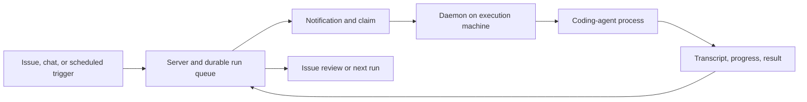

# Multica: issue-driven execution and coordination

**English** | [简体中文](lifecycle.zh-CN.md)

Read for architecture, delegation design, completion, and diagnosis.
Source IDs resolve in [sources.md](sources.md). Baseline: 2026-11-17.

## Architecture

Multica's web, desktop, and mobile surfaces use a Go backend with PostgreSQL.
For the local-runtime path, the backend coordinates a daemon on the connected
computer; the daemon launches installed agent CLIs. A runtime represents a
machine/tool combination or custom runtime profile available to a workspace.
One daemon can register several runtimes across workspaces. [M1–M3]



The source implements a machine-level batch claimer with WebSocket-first
requests and HTTP fallback, plus periodic polling and notification wakeups.
The daemon reserves execution slots; the backend also checks claim eligibility
and capacity. SQL claims use row locking with `SKIP LOCKED` to arbitrate queue
ownership. Notification receipt alone is not ownership of a run. [M8, M9]

The local-execution description does not cover every remote integration:
the documented Qoder Cloud Agents path uses a server-supervised bridge and
remote sessions without a user-operated local daemon. Identify the runtime
type before diagnosing where work should happen. [M3]

## Trigger and prepare

Assignments, structured mentions, chat, Autopilots, and issue wakeups can create
runs. Backlog assignment parks ordinary agent work. Queue admission can reject
an immediate action when the target runtime is known offline; accepted queued
work waits under the applicable reconnect rules. [M2–M5]

An agent provides instructions, model/provider settings, skills, and runtime
configuration. Project resources supply repositories or local directories.
Skills package reusable guidance; importing or attaching a skill is not itself
a worker scheduler. [M2, M12]

Choose the file-sharing model deliberately: [M10]

| Resource mode | Execution behavior |
| --- | --- |
| Repository-backed workspace | Uses isolated worktree execution by default for concurrent repository work. |
| Local directory, `in_place` | Edits the existing directory and its current state; runs sharing its real path serialize. |
| Local directory, `worktree` | Creates a separate Git worktree per run; requires a valid Git repository and runtime capability. |

An `in_place` contender enters `waiting_local_directory`. An unsupported
requested worktree mode fails or is refused; the documented path does not
silently downgrade to editing the original directory. Separate worktrees protect
working-copy independence, not the execution machine's overall filesystem. [M10, M11]

## Run lifecycle and durable reporting

The documented states are `deferred`, `queued`, `dispatched`,
`waiting_local_directory`, `running`, `completed`, `failed`, and `cancelled`.
`deferred` and directory waiting are conditional paths. `dispatched` means
claimed and starting; `running` means the agent is executing. [M4]

The daemon streams execution evidence and reports terminal results. The inspected
implementation attempts to persist complete/fail callbacks in a local outbox
before delivery. If persistence fails, it still attempts direct delivery, which
can succeed without a durable copy. Startup, reconnect-related wakeups, and
backoff replay pending reports;
acknowledged reports leave the queue. Permanent rejections can be quarantined,
so persistence is not an unlimited delivery guarantee. The stored report contains
no authentication token and replay uses the daemon's current credential. [M8]

On the server, `CompleteTaskWithTransition` uses a transaction and a conditional
`running → completed` update. It retains result/session/workdir/branch metadata
and relevant completion state. The caller only emits transition-owned external
side effects when it won that transition; duplicate terminal callbacks do not
re-run them. This is completion-delivery idempotence, not proof that arbitrary
commands inside the agent executed exactly once. [M9]

An execution can therefore finish on the machine while result delivery remains
unresolved. Check the run record and daemon's report-delivery errors before
starting duplicate work. [M8, M9; diagnostic advice is synthesis]

## Squads and multi-agent work

Assigning an eligible issue to a squad routes it to `leader_id`. The server
supplies the leader with an operating protocol, roster, and squad instructions.
Member role labels describe capabilities; they do not implement scheduling.
The leader chooses delegates and sends structured mentions. [M5]

In API/CLI comment content, use the roster's exact mention representation, such
as `[@Reviewer](mention://agent/<uuid>)`. Plain text `@Reviewer` is not a reliable
substitute for a structured mention. Agent mentions enqueue runs; human mentions
notify members. Delegation comments are therefore consequential writes. [M5]

The leader records its evaluation and ends the delegation turn. Replies and
applicable wakeups bring it back to coordinate the next step. Routing and dedup
rules prevent some redundant or self-triggered turns; do not assume every
comment starts every member or even always starts the leader. A squad mentioned
on somebody else's issue does not thereby gain authority over its status. [M5]

For independently verifiable pieces, parent/child issues can express staged
work. Create currently executable children as `todo`; keep later steps in
`backlog`. `--stage <N>` groups barriers. When a stage closes with later stages
waiting, or all children close, the platform wakes the parent assignee. The
assignee evaluates dependencies and promotes the next children. **The server
does not automatically promote all later stages.** [M6]

Barrier closure counts terminal children, including cancellations. Review their
outcomes before progressing: a closed prerequisite is not necessarily a
successful prerequisite. For custom statuses, inspect the lifecycle category or
stage counts instead of matching only literal status keys. [M6]

## Finish the work, not just the run

The run record answers whether that execution finished. The issue/workflow and
artifacts answer whether the requested work is accepted. Under the built-in
squad flow, the parent stays `in_progress` during delegation and moves to
`in_review` when the leader confirms the overall result. `done` belongs to the
human reviewer or configured integrations. A `[Project workflow]` block can
instead keep the issue at its step until its Step done action. [M2, M4, M5]

Check the result or PR, relevant tests, unresolved dependencies, and review state.
Automatic status movement or a successful process exit does not replace those
acceptance checks. This final verification advice is synthesis from the separation
of issue and run lifecycles; no product-wide correctness guarantee is implied.

## Failure, retry, and cancellation

The documented regular-run retry default is two total attempts for eligible
transient faults; tool-network interruption can allow three. Authentication,
quota, configuration, and most agent-reported failures require a cause-specific
repair. These are inspected defaults, not user budgets or universal values. [M4, M9]

Runtime liveness and task completion use different clocks. A healthy busy runtime
can retain queued work and long-running executions. Missing heartbeats, reconnect
grace, startup timeout, and daemon-side inactivity handling have different
purposes. Check the deployment's settings before declaring a task dead. [M3, M4]

Useful read-only checks from the documented CLI include:

```text
multica daemon status
multica daemon logs -n 100
multica issue get <issue-id> --output json
multica issue runs <issue-id> --full-id
multica issue children <parent-id> --output json
```

Use the daemon's correct profile. Desktop and default CLI profiles can have
different state directories; `daemon logs` prints the resolved path. For a
confirmed retry, `issue rerun-task <run-id>` uses the original run's agent and
trigger context, even after reassignment. It preserves safe continuity when
possible; `--fresh` requests a new session and working directory. Check what
earlier work exists before choosing. [M4, M13]

Use the execution log's Stop action or a verified current cancellation API to
interrupt execution. An issue-status change is not proof that a process stopped.
Inspect cancellation acknowledgement and the retained result/branch if the
outcome is uncertain. [M4, M8]

Autopilot **create issue** mode uses ordinary issue runs and their infrastructure
retry rules. **Run only** creates no issue, requires an available runtime at
trigger time, and has no ordinary automatic retries, avoiding overlap with the
next scheduled run. An issue wakeup resumes an existing issue's work. [M4, M7]

## Execution and data boundaries

For local runtimes, code and tool execution reside on the connected machine,
but prompts/context, comments, output, agent configuration, custom environment
variables, and MCP configuration can reside on the server. "Local" does not
mean that no code snippets or secrets can leave the machine. [M2, M3]

The security documentation gives local runs the daemon OS user's permissions
by default. A worktree or run-scoped configuration directory is not a general
filesystem sandbox. Assess the actual daemon/container/VM and provider settings
when explaining isolation. [M11]

This baseline is documentation and source inspection. It includes no live
Multica assignment, daemon execution, crash injection, or review/merge test.
