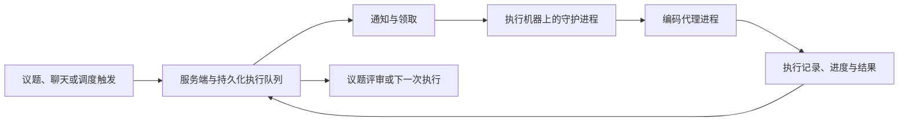

# Multica：围绕议题组织执行与协调

[English](lifecycle.md) | **简体中文**

本文用于理解架构、设计委派流程、判断完成状态和诊断问题。
来源编号见[来源索引](sources.zh-CN.md)。研究基准：2026-11-17。

## 架构

Multica 的网页、桌面和移动端使用 Go 后端与 PostgreSQL。
对于本地运行时，后端协调已连接计算机上的守护进程，再由守护进程启动已安装的代理 CLI。
Runtime 表示工作区可使用的“机器与工具”组合或自定义运行时配置。
一个 daemon 可以跨工作区注册多个 runtime。[M1–M3]



源码实现了机器级批量领取流程：优先使用 WebSocket 请求，必要时回退到 HTTP，
并结合周期性轮询和通知唤醒。守护进程预留执行槽位；后端也检查领取条件与容量。
SQL 领取操作通过行锁和 `SKIP LOCKED` 确定队列任务归属。
仅收到通知，并不代表已经取得某次 run 的执行权。[M8, M9]

本地执行模型不能涵盖所有远程集成。文档中的 Qoder Cloud Agents 路径通过服务端监督的桥接进程
使用远程会话，不需要用户自行运行本地 daemon。诊断工作应该在哪里执行之前，先确定运行时类型。[M3]

## 触发与准备

分配负责人、结构化提及、聊天、Autopilot 和议题唤醒均可创建 run。
将普通代理工作分配到 Backlog 会暂存任务。如果已知目标 runtime 离线，
部分即时操作可能在入队时被拒绝；已接受的队列任务则按对应的重连规则等待。[M2–M5]

Agent 提供指令、模型/提供商设置、技能和运行时配置。
项目资源提供仓库或本地目录。技能封装可复用的指导；导入或挂载技能本身不会调度工作代理。[M2, M12]

应明确选择文件共享模式：[M10]

| 资源模式 | 执行行为 |
| --- | --- |
| 仓库工作区 | 默认使用隔离的 worktree 执行，以支持同一仓库中的并行工作。 |
| 本地目录，`in_place` | 直接修改现有目录及其当前状态；访问同一真实路径的多个 run 串行执行。 |
| 本地目录，`worktree` | 为每个 run 创建独立 Git worktree；需要有效的 Git 仓库和对应 runtime 能力。 |

竞争同一目录的 `in_place` 任务进入 `waiting_local_directory`。
如果明确请求的 worktree 模式不受支持，操作会失败或被拒绝；
文档描述的路径不会静默降级为修改原目录。
独立 worktree 保持工作副本相互独立，但不会隔离执行机器的整个文件系统。[M10, M11]

## 执行生命周期与持久化结果回报

文档列出的状态包括 `deferred`、`queued`、`dispatched`、`waiting_local_directory`、
`running`、`completed`、`failed` 和 `cancelled`。
`deferred` 和目录等待只在特定路径出现。`dispatched` 表示任务已领取、正在启动；
`running` 表示代理正在执行。[M4]

守护进程流式上传执行证据，并回报终态结果。检查的实现在投递前尝试将 complete/fail 回调
持久化到本地发件队列。如果持久化失败，仍会尝试直接投递，因此投递成功时也可能没有持久化副本。
启动、与重连相关的唤醒及退避机制会重放待投递报告；确认收到的报告随后移出队列。
永久拒绝可能使报告进入隔离区，因此持久化并不代表无限期保证投递。
存储的报告不包含身份验证令牌，重放时使用 daemon 当前的凭据。[M8]

服务端的 `CompleteTaskWithTransition` 使用事务以及有条件的 `running → completed` 更新。
它保存结果、会话、工作目录、分支元数据和相关完成状态。
仅当调用方成功执行了这次状态转换时，才产生属于该转换的外部副作用；重复终态回调不会再次产生这些副作用。
这体现的是完成结果投递的幂等处理，不能证明代理内部的任意命令都只执行了一次。[M9]

因此，机器上的执行可能已经结束，而结果投递仍未确定。
启动重复工作前，先检查 run 记录和 daemon 的报告投递错误。[M8, M9；诊断建议为综合分析]

## Squad 与多代理协作

将符合触发条件的议题分配给 squad，会路由到其 `leader_id`。
服务端向领导代理提供运行协议、成员名单和团队指令。
成员的角色标签用于描述能力，不会自动实现调度。
领导代理选择受托成员，并发送结构化提及。[M5]

通过 API/CLI 提交评论时，应使用名单给出的确切提及格式，例如
`[@Reviewer](mention://agent/<uuid>)`。
普通文本 `@Reviewer` 不能可靠地替代结构化提及。
提及代理会创建队列执行，提及人类成员会通知对方；因此委派评论是具有实际影响的写入操作。[M5]

领导代理记录判断结果，然后结束委派回合。成员回复及适用的唤醒机制会再次启动领导代理，协调下一步。
路由和去重规则会抑制部分重复或自触发回合；不能认为每条评论都会启动所有成员，
也不能认为每条评论都会启动领导代理。
在他人负责的议题中被提及的 squad，不会因此获得修改该议题状态的权限。[M5]

对于能够独立验收的工作，可以通过父子议题表示分阶段任务。
当前即可执行的子议题设为 `todo`，后续步骤保留在 `backlog`。
`--stage <N>` 将子议题组织成阶段关卡。
当某阶段关闭且后续阶段仍在等待，或所有子议题都关闭时，平台唤醒父议题负责人。
负责人检查依赖后，再推进下一组子议题。**服务端不会自动推进所有后续阶段。**[M6]

关卡关闭会计入所有处于终态的子议题，包括取消的子议题。
继续推进前应检查实际结果：前置任务已关闭，不一定代表前置条件已成功满足。
遇到自定义状态时，应检查生命周期类别或阶段统计，而不只匹配固定状态名称。[M6]

## 判断工作是否完成

Run 记录回答的是“这次执行是否结束”。议题、工作流和产物回答的是“请求的工作是否已通过验收”。
在内置 squad 流程中，委派期间父议题保持 `in_progress`，领导代理确认整体结果后才移到 `in_review`。
`done` 由人工评审者或配置好的集成处理。
如果存在 `[Project workflow]` 指令块，则可能要求议题保持当前步骤，直到执行其 Step done 操作。[M2, M4, M5]

需要检查结果或 PR、相关测试、未解决的依赖及评审状态。
自动状态变化或进程成功退出不能替代这些验收。
上述最终验证建议来自对议题生命周期与执行生命周期区别的综合分析，不意味着产品保证所有工作都正确。

## 失败、重试与取消

文档中的普通 run 对符合条件的临时故障默认最多执行两次；工具网络中断时可能允许三次。
身份验证、配额、配置问题和大部分代理主动报告的失败，都需要针对原因修复。
这些数字是研究版本的默认值，不是用户指定的预算，也不是普遍适用的常数。[M4, M9]

运行时存活与任务完成采用不同的计时规则。
健康但繁忙的 runtime 可以持续保留排队任务和长时间执行的任务。
心跳丢失、重连宽限期、启动超时及 daemon 端的无活动检测各有不同用途。
判断任务已经失效前，先检查当前部署的设置。[M3, M4]

文档中可用于只读检查的 CLI 命令包括：

```text
multica daemon status
multica daemon logs -n 100
multica issue get <issue-id> --output json
multica issue runs <issue-id> --full-id
multica issue children <parent-id> --output json
```

应使用正确的 daemon profile。Desktop 与默认 CLI profile 可能使用不同的状态目录；
`daemon logs` 会显示解析出的日志路径。
确认需要重试后，`issue rerun-task <run-id>` 使用原 run 的代理和触发上下文，
即使议题后来更换了负责人也如此。条件安全时会尽量延续原会话和工作；
`--fresh` 则请求新会话和新工作目录。选择前先确认上次留下了什么。[M4, M13]

要中断执行，应使用执行日志中的 Stop 操作，或经核实的当前取消 API。
修改议题状态不能证明进程已经停止。结果不确定时，检查取消确认以及保留的结果和分支。[M4, M8]

Autopilot 的 **create issue** 模式使用普通议题 run 及其基础设施故障重试规则。
**Run only** 不创建议题，触发时要求 runtime 可用，也不执行普通自动重试，
从而避免与下一次计划执行重叠。议题唤醒用于继续处理已有议题。[M4, M7]

## 执行边界与数据边界

对于本地运行时，代码和工具执行位于已连接的机器上；但提示词、上下文、评论、输出、代理配置、
自定义环境变量及 MCP 配置可能保存在服务端。
“本地执行”不代表代码片段或秘密一定不会离开机器。[M2, M3]

安全模型文档说明，本地 run 默认拥有运行 daemon 的操作系统用户权限。
Worktree 或单次 run 专用的配置目录并非通用文件系统沙箱。
解释隔离能力时，应检查实际 daemon、容器、虚拟机和提供商设置。[M11]

本研究基于文档和源码检查，没有实际执行 Multica 任务分配、daemon 运行、故障注入或评审/合并测试。
