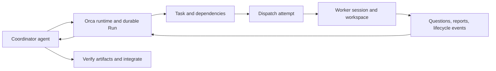

# Orca: from objective to settled worker results

**English** | [简体中文](lifecycle.zh-CN.md)

Read for architecture, operating-model comparisons, and failure diagnosis.
Source IDs resolve in [sources.md](sources.md). Baseline: 2026-11-17.

## Architecture and durable identity

The CLI calls the running Orca runtime. Orchestration is documented as an
experimental feature requiring enablement in settings. The runtime keeps a
SQLite database for Runs, Tasks, Dispatches, worker records, gates, and mail.
The inspected database opens in WAL mode; Task/Dispatch settlement uses lifecycle
transactions. These records make coordination inspectable beyond one agent turn.
They do not make a Run an autonomous scheduler. [O1, O2, O6]



Tasks have `pending`, `ready`, `dispatched`, `completed`, `failed`, and `blocked`
states. Dispatches have their own attempt state. A worker can be gone, unknown,
or awaiting recovery while the logical Task still needs resolution. Preserve
the Run, Task, Dispatch, and execution location when diagnosing such a case. [O1, O6]

## Launch and placement

Give each worker a self-contained spec: target, permitted edits, constraints,
deliverable, and acceptance evidence. Specify whether a nonzero command exit is
a task failure or the evidence being collected. [O2]

The current guide supports a short path:

```text
ORCA orchestration worker-start --spec "<bounded task and evidence>" --worktree current --agent <agent>
```

Here and below, `ORCA` means the resolved executable, not a literal command.
For an explicit task graph:

```text
ORCA orchestration run-create --objective "<overall result>"
ORCA orchestration task-create --spec "<task with acceptance criteria>"
ORCA orchestration worker-start --task <task-id> --worktree current --agent <agent>
```

Pass the intended Run explicitly when working across several Runs. Dependencies
are supplied through `task-create --deps <json-array>`; after a wake, the
coordinator checks `task-list --ready --brief` and starts eligible work. Creating
records alone does not launch every ready Task. [O1–O3]

`current` shares the current workspace. Use `new-child` or `new-top-level` for
separate Git worktrees where simultaneous edits would conflict. Folder workspaces
are valid, but worktree creation requires a Git project. Isolation is an explicit
placement choice; supervised workers do not invariably get a new checkout. [O2, O4]

For a connected server, `worker-start --on <server>` creates the worker there
while the Run stays home. New-worktree placement requires an exact repository
selector on that server; `current` is invalid with `--on`. Later operations use
the Dispatch ID. Check host capabilities and readiness instead of assuming the
local CLI, agent installation, or model selection applies remotely. [O4]

## Communication and decisions

Start the independent workers, then yield. The current guide uses runtime wakes,
including whole messages in supported chat surfaces or an instruction to run
`orchestration check`. Follow the receipt's `next` action. A background script
calling plain `check` can consume mail before the coordinator sees it. [O1, O2]

Plain `check` consumes unread mail. `--peek` and `--all` are inspection views and
do not drain it. Some older releases require explicit delivery acknowledgement;
follow that build's receipt. Keep inspection and consumption distinct. [O1]

Workers use `ask` for questions and yield until the response wakes them.
Coordinators reply to the question ID. Explicit decision gates block Tasks until
the coordinator records a resolution. A decision gate is distinct from an agent
tool-permission prompt; permission approval follows the worker host's settings
and the user's authorization. [O1]

Steer supervised workers with `send --to dispatch:<dispatch-id>`, preserving
assignment identity. A working local worker receives it after its current turn;
a settled or closed local worker can receive a follow-up Task. The guide records
a limitation for finished workers on paired servers: start new work there using
the supported remote placement flow. [O2, O4]

## Completion: report, settlement, acceptance

The dispatched preamble supplies the IDs. The worker reports once, including
failure, using this shape: [O1]

```text
ORCA orchestration send --type worker_done --task-id <task-id> --dispatch-id <dispatch-id> --outcome succeeded --subject "<result>" --body "<changes, checks, remaining work>"
```

Use `--outcome failed` when the task failed. The runtime validates the Task and
Dispatch relationship and active attempt, rejects mismatches/conflicts/stale
attempts, and transactionally updates the lifecycle. Accepted duplicate
settlements are recognized. The inspected path also closes dispatch questions,
records report observations, and can arm automatic worker release. [O6, O7]

The CLI accepts a lifecycle verdict; for legacy responses without one, it reads
back the Task, Dispatch, and report provenance to confirm settlement. An
`operation_unknown` receipt is an unresolved outcome. Preserve its mutation
request identity and follow its recovery instruction rather than sending a new
completion with a fresh identity. [O8]

This supplies coordination correctness, not proof of software correctness.
Review the artifact and the worker's relevant test evidence. Check integration
when changes interact. Report per Task: outcome, evidence, and remaining blockers.
A settled failed Task remains a failure. [O2; acceptance advice is synthesis]

## Recovery and cleanup

| Observation | Supported next investigation |
| --- | --- |
| Launch failed | Inspect `failedStage`, `worker-show`, and retained output; do not blindly repeat `worker-start`. |
| Worker stopped without `worker_done` | Treat its escalation as unresolved work; choose steering, a justified retry, or user escalation. |
| Silence, timeout, or unverifiable liveness | Establish identity and liveness; these observations alone do not prove exit. |
| `stop_unknown` | Read current worker state and the receipt; do not claim cancellation or immediately launch a replacement. |
| `release_pending` / `release_unknown` | Follow the exact release recovery action; a broad terminal close is not equivalent. |

Retry the **same Task** with `--retry-of <dispatch-id>` and explicit placement;
placement is not inherited. The current recovery guide circuit-breaks after
three failed starts in one retry chain; a worker's failed report does not count
as a failed start. Stop automatic retries at the breaker. The guide requires
an explicit user retry/reassignment before reopening that Task. [O5]

`worker-abandon` fences an assignment but can retain a live process. Guarded
`worker-stop` attempts physical cancellation; only a confirmed stopped receipt
proves it. `worker-release` archives inspectable output and closes eligible owned
worker terminals. Keep-open and user-owned resources require their own handling.
`reset` discards runtime-global orchestration state; it is not routine recovery. [O1, O5]

## Common interpretation errors

- An old `orchestration run`, `run-stop`, or coordinator-start tutorial is not
  evidence for current operation; the inspected docs mark those commands retired.
- More terminal panes do not automatically provide task ownership or completion tracking.
- Worktrees separate file edits; integration remains part of delivering the overall objective.
- Runtime persistence and wake delivery are not a promise of unlimited autonomous progress.

These distinctions are supported by the model and workflow above. No live worker
execution, crash-recovery experiment, remote dispatch, or integration test was
performed as part of this research baseline.
