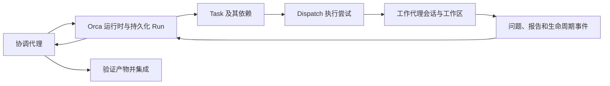

# Orca：从目标到工作代理结果的终态确认

[English](lifecycle.md) | **简体中文**

本文用于理解架构、比较运行模式和诊断故障。
来源编号见[来源索引](sources.zh-CN.md)。研究基准：2026-11-17。

## 架构与持久化身份

CLI 调用正在运行的 Orca 运行时。官方文档将编排列为需要在设置中启用的实验性功能。
运行时通过 SQLite 数据库存储 Run、Task、Dispatch、工作代理记录、决策关卡和消息。
检查的实现以 WAL 模式打开数据库，并通过生命周期事务确认 Task/Dispatch 的终态。
因此，协调状态可以跨越单次代理回合被查询；这些记录不会使 Run 自动变成调度器。[O1, O2, O6]



Task 包含 `pending`、`ready`、`dispatched`、`completed`、`failed` 和 `blocked` 状态。
Dispatch 有独立的尝试状态。当工作代理已经消失、状态未知或等待恢复时，逻辑上的 Task
可能仍未解决。诊断这类情况时，保留 Run、Task、Dispatch 及执行位置之间的对应关系。[O1, O6]

## 启动与执行位置

为每个工作代理提供完整的任务说明，包括目标、允许修改的内容、约束、交付物及验收证据。
明确命令返回非零退出码是代表任务失败，还是恰好属于本次任务需要收集的证据。[O2]

当前指南支持以下简化流程：

```text
ORCA orchestration worker-start --spec "<bounded task and evidence>" --worktree current --agent <agent>
```

此处及下文的 `ORCA` 代表已确定的可执行文件，并非要求直接输入这个名字。
要显式创建任务图，可以使用：

```text
ORCA orchestration run-create --objective "<overall result>"
ORCA orchestration task-create --spec "<task with acceptance criteria>"
ORCA orchestration worker-start --task <task-id> --worktree current --agent <agent>
```

同时处理多个 Run 时，显式指定目标 Run。依赖关系通过 `task-create --deps <json-array>` 提供；
每次被唤醒后，协调者查看 `task-list --ready --brief`，再启动符合条件的工作。
仅创建记录不会自动启动所有就绪的 Task。[O1–O3]

`current` 会共享当前工作区。如果并行修改可能冲突，使用 `new-child` 或 `new-top-level`
创建独立的 Git worktree。普通文件夹工作区也可使用，但创建 worktree 必须有 Git 项目。
是否隔离取决于明确的执行位置选择；受监督的工作代理并不总会获得一个新检出目录。[O2, O4]

对已连接服务器使用 `worker-start --on <server>` 时，工作代理在目标服务器上启动，
Run 仍保留在原运行时。新建 worktree 时需要提供该服务器上精确的仓库选择器；
`current` 不能与 `--on` 一起使用。后续操作通过 Dispatch ID 定位。
应检查执行主机的能力和就绪状态，不能假设本机 CLI、代理安装或模型选择也适用于远端。[O4]

## 沟通与决策

启动独立工作代理后，结束当前回合并等待唤醒。当前指南使用运行时唤醒机制：
在支持的聊天界面中直接交付完整消息，或提示执行 `orchestration check`。
遵循回执中的 `next` 操作。后台脚本若调用普通 `check`，可能在协调者看到消息前就将其消费。[O1, O2]

普通 `check` 会消费未读消息。`--peek` 和 `--all` 用于查看，不会清空未读队列。
部分旧版本要求显式确认投递；以该版本的回执为准。应区分“查看消息”和“消费消息”。[O1]

工作代理通过 `ask` 提问，然后结束当前回合，等待答复唤醒。
协调者根据问题 ID 回复。显式决策关卡会阻塞 Task，直到协调者记录决议。
决策关卡与代理工具的权限提示属于不同机制；权限批准仍遵循工作代理所在主机的设置和用户授权。[O1]

通过 `send --to dispatch:<dispatch-id>` 向受监督的工作代理发送指示，保持分配身份不变。
正在工作的本地代理会在当前回合结束后收到消息；已提交终态或已关闭的本地代理可以接收后续 Task。
当前指南记录了配对服务器上的限制：远端工作代理结束后，应通过受支持的远程执行流程启动新工作。[O2, O4]

## 完成：报告、终态确认与验收

派发时注入的前置说明会提供所需 ID。工作代理应提交一次报告，失败时也必须报告，格式如下：[O1]

```text
ORCA orchestration send --type worker_done --task-id <task-id> --dispatch-id <dispatch-id> --outcome succeeded --subject "<result>" --body "<changes, checks, remaining work>"
```

任务失败时使用 `--outcome failed`。运行时验证 Task 与 Dispatch 的关系及当前有效尝试，
拒绝不匹配、冲突或过期的尝试，并以事务方式更新生命周期。
已接受的重复终态报告可以被识别。检查到的路径还会关闭该 Dispatch 的问题、
记录报告观测结果，并可安排自动释放工作代理。[O6, O7]

CLI 使用生命周期判定结果；若旧版响应不包含该判定，它会回读 Task、Dispatch 和报告来源来确认终态。
`operation_unknown` 回执表示结果尚未确定。
应保留原修改请求的身份，并遵循回执的恢复指示，不能换一个新请求身份重新提交完成报告。[O8]

这些机制保障的是协调状态的正确处理，不能作为软件正确性的证明。
需要检查产物和工作代理提供的相关测试证据；多个修改相互影响时，还要验证集成结果。
按 Task 汇报结果、证据和剩余阻塞。已确认终态的失败 Task 仍然是失败。[O2；验收建议为综合分析]

## 恢复与清理

| 观察结果 | 有依据的下一步检查 |
| --- | --- |
| 启动失败 | 查看 `failedStage`、`worker-show` 和保留的输出；不要盲目重复 `worker-start`。 |
| 工作代理停止，但未提交 `worker_done` | 将其升级通知视为尚未解决的工作，选择继续指导、有依据的重试或请求用户处理。 |
| 无输出、超时或无法验证存活状态 | 先确定身份和存活情况；这些现象本身不能证明进程已退出。 |
| `stop_unknown` | 查看当前工作代理状态和回执；不要宣称已取消，也不要立即启动替代代理。 |
| `release_pending` / `release_unknown` | 按确切的释放恢复指示处理；直接关闭整个终端并不等价。 |

重试应针对**同一个 Task**，使用 `--retry-of <dispatch-id>`，并显式指定执行位置；
执行位置不会从前一次尝试继承。当前恢复指南规定，同一重试链连续发生三次启动失败后触发熔断；
工作代理主动报告任务失败不计入“启动失败”。触发熔断后停止自动重试。
指南要求用户明确请求重试或重新分配后，才可重新打开该 Task。[O5]

`worker-abandon` 会隔离该分配，使旧分配不能继续生效，但可能保留仍在运行的进程。
受保护的 `worker-stop` 尝试真正取消执行；只有明确确认 stopped 的回执才能证明已停止。
`worker-release` 归档可查询的输出，并关闭符合条件、属于协调者的工作代理终端。
Keep-open 或已由用户接管的资源需要单独处理。
`reset` 会丢弃整个运行时的编排状态，不应作为常规恢复方式。[O1, O5]

## 常见误解

- 旧教程中的 `orchestration run`、`run-stop` 或 coordinator-start 不能作为当前操作依据；
  检查的文档已将这些命令标为退役。
- 增加终端窗格不会自动建立任务归属或完成跟踪。
- Worktree 分离文件修改；集成仍是交付整体目标的一部分。
- 运行时持久化和唤醒投递不代表可以无限自主推进。

上述区别以本文模型和流程为依据。本研究基准没有实际运行工作代理，也没有进行崩溃恢复实验、
远程派发或集成测试。
